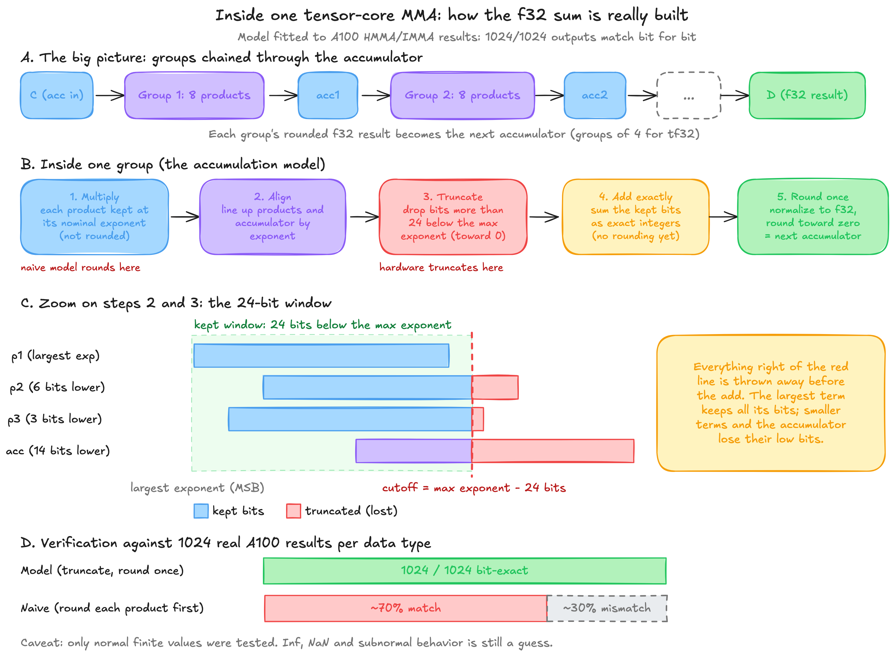
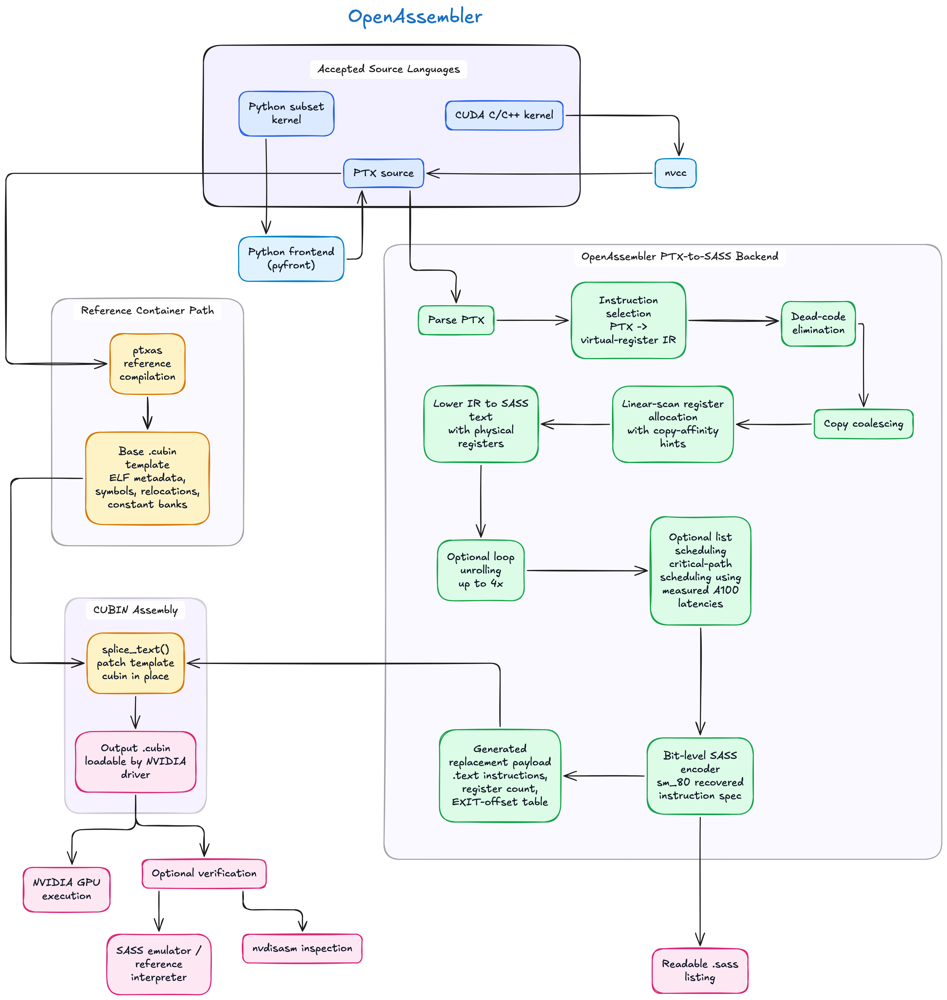

  <p align="center"></p>

<div align="center">

# OpenAssembler

**OpenAssembler 0.2.0 — Python / CUDA C & C++ / PTX to NVIDIA SASS and cubin.**

Compile GPU kernels from a file or a repository, inspect their SASS, and execute
compiled outputs locally, over SSH, or on Modal. The backend targets **sm_80**.
Performance varies by workload: recorded microbenchmarks span 0.92×–1.36× ptxas,
while the naive MLP remains slower. These are kernel measurements, not a claim
of a general LLM or training speedup.

[](LICENSE)
[-76b900)](#)

[What this is](#what-this-is) ·
[Quick start](#quick-start) ·
[What we found](#what-we-found-on-real-hardware) ·
[How it works](#how-it-works) ·
[NN study](docs/NN_OPTIMIZATION_STUDY.md) ·
[Results](#results) ·
[Reproduce it](REPRODUCING.md)

</div>

---

## What this is

`ptxas`, NVIDIA's PTX-to-SASS compiler, is closed source. **OpenAssembler is a
second implementation of it**, built by treating `ptxas` as a black box and
reverse-engineering its instruction encoding, scheduling, and ELF container
format from the outside — then replacing its code generator with our own.

Concretely, this repo contains:

- **A SASS encoder/decoder for sm_80 (Ampere)** — opcodes, operand forms,
  control bits (stall, yield, scoreboards, wait masks) — recovered by bit-flip
  fuzzing against `nvdisasm` ([docs/findings-sm80-encoding.md](docs/findings-sm80-encoding.md)).
- **A Python / CUDA C/C++ / PTX → SASS compiler** (register allocation, scheduling, 4× loop
  unrolling). A historical 203-probe run emitted 2,132 instructions versus ptxas's
  2,249 (-5.2%). Selected microbenchmarks ranged from 0.92× to 1.36× ptxas speed;
  NN/transformer baselines and their numerical mismatches are reported separately.
- **A functional SASS emulator**, fitted to real A100 behaviour:
  tensor-core (HMMA/IMMA/DMMA) numerics bit-exact on 512/512 recorded lanes,
  instruction latencies measured directly on hardware (not guessed from
  `nvdisasm`'s mined minimum distances, which are provably wrong — see
  below).
- **Division/remainder by a constant**, replacing `ptxas`'s always-runtime
  reciprocal sequence with a [z3-proven](openassembler/opt/divconst.py)
  multiply-high lowering: **13 → 2–3 instructions**.
- **Strassen / AlphaTensor fast matrix multiplication**: 97 published
  low-rank factorizations of matrix multiply (AlphaTensor, DeepMind/Nature
  2022) imported, verified exactly over the rationals, compiled by our
  backend, and measured against cuBLAS on an A100 at n = 8192.
- **Python and CUDA C/C++ frontends**: write a kernel in a Python subset
  (`openassembler/pyfront/`, built from scratch) or in CUDA C/C++ (lowered to PTX
  by `nvcc`), and it is compiled to SASS by our backend
  ([docs/FRONTENDS.md](docs/FRONTENDS.md)).
- **`openassembler`, a CLI** that ties all of this together: compile a PTX, Python
  or CUDA C file to a `.cubin` plus a readable `.sass` with our backend, verify it
  against a reference interpreter, and run compiled cubins against a ptxas reference
  on a local GPU, an SSH host, or a cloud GPU. The separate `gpu run` command tests
  the probe corpus.

Every measurement is tied to a workload and hardware. [REPRODUCING.md](REPRODUCING.md) gives the commands; [docs/STATUS.md](docs/STATUS.md) records historical results.

> OpenAssembler uses a ptxas-built ELF container for metadata and replaces the
> kernel text with words generated by its own backend; see [How it works](#how-it-works).
> The current unsupported areas are listed in [docs/FRONTENDS.md](docs/FRONTENDS.md)
> and [docs/STATUS.md](docs/STATUS.md).

---

## Quick start

### Install
```bash
git clone https://github.com/Qingyang-Lucas-Fang/OpenAssembler.git && cd OpenAssembler
python3 --version                  # must be 3.12 or newer
python3 -m venv .venv && source .venv/bin/activate
pip install -e .                   # installs the `openassembler` command into the venv   
```
Needs **Python 3.12+** (`openassembler` has no Python dependencies). To run the tests too: `pip install pytest`. On Debian/Ubuntu, `sudo apt install python3-venv xz-utils` first (a minimal install has neither); compiling CUDA C also needs a host `g++`.

| Your machine | Supported? |
|---|---|
| Linux (x86_64 or ARM64) | yes, native |
| macOS (Apple Silicon or Intel) | yes: NVIDIA's tools only run on Linux, so they run in a small Linux VM ([colima](https://github.com/abiosoft/colima)) that `env/cuda.sh` drives for you; keep the repo under your home directory |

Windows is not supported.

You do **not** need an NVIDIA GPU to compile, only to run the result (see [Run it on a real GPU](#run-it-on-a-real-gpu)).


### Set up NVIDIA's toolkit (once)

Compiling needs `ptxas`, `nvdisasm` and (for CUDA C) `nvcc`. NVIDIA's license doesn't let us ship them,
so `env/fetch_cuda.sh` downloads CUDA 12.8 straight from NVIDIA and checks it against NVIDIA's published
checksums. It picks the build that matches your CPU. On macOS, start the VM first:

```bash
brew install colima && colima start        # macOS only; skip on Linux
```
```bash
env/fetch_cuda.sh                       # for both macOS and linux
env/cuda.sh ptxas --version              # must print "release 12.8"
```
Already have CUDA on a Linux box? Point `OPENASSEMBLER_CUDA_HOME` at it (or just have `ptxas`/`nvdisasm`/`nvcc` on `PATH`); the numbers in this repo were measured with 12.8.

### Run OpenAssembler
```bash
openassembler
```
With no arguments this opens an interactive shell (history, tab completion) that takes every command below without the `openassembler` prefix (so you do not need to include the `openassembler` command). Every command also works one-shot, e.g. `openassembler status`.

Here is the expected display:


---

### Compile your first kernel

One command turns a kernel into a loadable **`.cubin`** and a readable **`.sass`** listing, and `--verify` checks the result is bit-exact against a reference interpreter:

```bash
compile examples/div_by_const.ptx -o out --verify
# -> output/cubin/out.cubin   (the binary the GPU driver loads)
# -> output/sass/out.sass     (the readable SASS disassembly)
# -> output/manifest.json
```

The kernel can be PTX, a small Python subset, or CUDA C/C++, and all three end in our backend:

```bash
compile examples/vector_add.py  -o out --verify   # Python  -> SASS + cubin
compile examples/vector_add.cu  -o out --verify   # CUDA C  -> SASS + cubin
```

What each language accepts, what is rejected, and the exact limits of `--verify` are in
**[docs/FRONTENDS.md](docs/FRONTENDS.md)**. `-o` is a logical output name. Use `--out-dir DIR` to choose the output folder; the command writes `DIR/cubin/NAME.cubin`, `DIR/sass/NAME.sass`, and `DIR/manifest.json`.

---

### Compile a repository and run it

A directory compile walks tracked and non-ignored files, recognizes PTX entries, CUDA C/C++ files containing `__global__`, and Python files containing OpenAssembler `@kernel` functions. Shell scripts, host-only files, virtual environments, and generated output are skipped and counted. GPU kernels in test files are included when they match the discovery rules. The source tree is mirrored below the output folder:

```bash
openassembler compile my_repo/ --out-dir output --verify
# output/cubin/kernels/gemm.cubin
# output/sass/kernels/gemm.sass
# output/manifest.json
```

`compile` only builds. `run output` executes already-built cubins on a local GPU, an SSH Linux GPU, or Modal and compares each selected output buffer with the ptxas reference recorded in the manifest. `cnr SRC` combines the two commands and runs only the kernels compiled in that invocation.

For non-trivial launches, create a JSON `--spec` describing buffers, arguments, grid, block, and the buffers to compare. The schema and examples are in [docs/FRONTENDS.md](docs/FRONTENDS.md). The automatic harness is intentionally conservative and is suitable for simple one-dimensional kernels.

```bash
openassembler run output --backend modal --dry-run
openassembler run output --backend modal --spec examples/run_spec.json --budget 120
openassembler cnr examples/vector_add.py --backend modal --dry-run
```

### Run it on a real GPU

The probe corpus commands below validate the compiler itself. They are separate from `run`, which consumes a project manifest.

```bash
openassembler corpus
openassembler check
openassembler gpu run --backend modal --dry-run
openassembler gpu run --backend modal
```

### Reproduce a Modal run

After installing the toolkit and package above, install the optional Modal client
and authenticate. The following commands were exercised with Modal client 1.6.2:

```sh
pip install modal==1.6.2
modal setup
openassembler compile examples/vector_add.py -o vector_add --out-dir output --verify
openassembler run output --backend modal --spec examples/run_spec.json --dry-run --budget 60 --job-timeout 20
openassembler run output --backend modal --spec examples/run_spec.json --budget 60 --job-timeout 20
openassembler cnr examples/vector_add.py --backend modal --spec examples/run_spec.json --budget 60 --job-timeout 20
modal app list
modal container list
```

Use `--gpu A100-40GB` (the default) for sm_80 validation. The report records the
actual device delivered. The dry run starts no GPU and prints the upload size,
launch plan, estimated cost, and exact command. Prices are estimates, not a
billing guarantee. `--budget` bounds batch execution, `--job-timeout` bounds each
job, and the Modal function has a hard timeout; startup overhead may add billing.
Reports are saved under `output/runs/` with UTC timestamps and as `output/run.json`.

If the client is interrupted, inspect `modal app list` and `modal container list`;
stop only the leftover OpenAssembler app with `modal app stop APP_ID`. No
`modal shell` is needed. The cloud environment receives the job payload and the
small GPU runner package, not the entire source repository. See
[REPRODUCING.md](REPRODUCING.md#modal-reproduction) for the probe and timing suites.

---

## What we found on real hardware

Everything here was measured on an A100-SXM4-40GB rented by the minute
through [Modal](https://modal.com) (see [REPRODUCING.md](REPRODUCING.md) for
cost and the exact commands). A few findings that surprised us:

- **`ptxas`'s own "mined minimum distances" are not real latencies.** Two
  instructions that `ptxas` sometimes schedules 4 cycles apart actually need
  5 on real hardware; using 4 gives wrong results. We measured the real
  numbers directly: **4 cycles within a pipe, 5 across pipes**, and a
  **13-cycle minimum** from a predicate write to any instruction that guards
  on it — confirmed by sweeping every `stall` field from 1–15 against the
  A100 (`corpus/sm_80/hw_latency.json`).
- **The register count declared in the cubin isn't just advisory.** Writing
  register `Rd` faults with `CUDA_ILLEGAL_INSTRUCTION` unless the declared
  count is ≥ `Rd + 3` — and that count lives in **two places**: the
  `EIATTR_REGCOUNT` record *and* bits 24–31 of the `.text.<kernel>` section's
  ELF `sh_info`. We only found the second one by faulting a real GPU
  (`corpus/sm_80/gpu_a100_40gb_bisect5.json`, 77 variants).
- **Tensor-core accumulation is truncating, not rounding, per term**, and the
  model below matches **100% of 512 recorded A100 lanes** per data type
  (f16/bf16/tf32/s8/f64) — the next-best model we tried only matched ~70%:

  <p align="center"></p>

- **A hidden bit survives disassembly.** A template we synthesized by
  flipping bits kept 0xad of an old immediate in `ISETP` bits 32–39.
  `nvdisasm` doesn't print those bits — but the hardware reads them, and a
  stale value made every affected loop run one extra iteration.

The full list of discoveries regarding the closed source nvidia assembly language and MMA operations details, each with the measured file behind it, is in
[docs/STATUS.md](docs/STATUS.md#what-the-a100-taught-us-each-finding-has-a-recorded-run-behind-it).

---

## Results

### Our compiler vs. `ptxas`, same PTX, A100-measured wall-clock

4096 CTAs × 32 threads, 4096 loop iterations, best median of 3 shuffled
timing rounds (a fixed order biases results — see
[docs/STATUS.md](docs/STATUS.md), "Timing method"):

| kernel | ptxas (ms) | ours, best variant (ms) | **ptxas / ours** |
|---|---|---|---|
| `loop.div7` (division by 7) | 0.629 | 0.464 | **1.36×** |
| `loop.rem1000` | 0.373 | 0.312 | **1.19×** |
| `loop.smem` | 0.748 | 0.713 | 1.05× |
| `ilp4.imad` | 0.257 | 0.250 | 1.03× |
| `ilp4.ffma` | 0.257 | 0.254 | 1.01× |
| `chain.imad_lop3` (dependent chain) | 0.129 | 0.135 | 0.95× |
| `chain.ffma` (dependent chain) | 0.089 | 0.097 | 0.92× |

All 49 cubins from this table are bit-exact against each other across runs.
We win on division (magic-number lowering vs. `ptxas`'s always-runtime
reciprocal) and on loops with enough work to hide scheduling latency; `ptxas`
still wins tight dependent chains by 5–8%, because it hides the loop counter
and branch inside the chain and we pay a 13-cycle predicate wait per
unrolled trip (see [Future Improvements](#future-improvements)).

### Strassen / AlphaTensor fast matmul vs. cuBLAS, fp32, n = 8192, A100

| plan | our compiler (ms) | vs. cuBLAS | rel. error |
|---|---|---|---|
| cuBLAS SGEMM (reference) | 57.6 | 1.000× | 1.6e-6 |
| our direct GEMM | 60.0 | 0.960× | 1.6e-6 |
| **Strassen ⟨2,2,2⟩, rank 7** | **58.4** | 0.986× | 2.3e-6 |
| **AlphaTensor ⟨2,2,2⟩, rank 7** | **58.3** | 0.988× | 2.7e-6 |
| AlphaTensor 4×4×4, rank 49 | 71.6 | 0.804× | 5.7e-6 |

One level of Strassen's rank-7 decomposition trades 12.5% fewer block
multiplications for a 2.7% speedup over our own direct GEMM — the classic
result (DeepMind, *Nature* 2022), reproduced end to end on our own backend.
4×4×4 schemes lose at this size: the block GEMMs become too small to fill
108 SMs. Full table, every scheme, and the n = 2048/4096 crossover in
[docs/STATUS.md](docs/STATUS.md#fast-matrix-multiplication-alphatensor-schemes--our-compiler--a100).

### Correctness, not just speed

| | |
|---|---|
| Our compiler's cubins on real hardware | recorded probe evidence is versioned under `corpus/sm_80/`; rerun the Modal commands in `REPRODUCING.md` after changing the backend |
| Emulator vs. real A100 (`ptxas` cubins) | **532/541 probes** bit-exact or within PTX spec tolerance |
| Tensor cores (HMMA/IMMA/DMMA, LDSM, LDGSTS) | bit-exact on 512/512 recorded lanes, every dtype |
| Division/remainder-by-constant lowering | proved equal to `/` and `%` by z3 (exhaustive for 32-bit) |
| Strassen/AlphaTensor factorizations | all 97 verified exactly over ℚ |
| Tests | run `uv run pytest -q`; toolkit-dependent tests report a skip when the CUDA oracle is unavailable |

---

## How it works

<p align="center"></p>

`ptxas` supplies the ELF container and reference binary for the same PTX. Our
backend replaces kernel instruction words, register metadata, and exit offsets.
SASS is the human-readable representation of those instructions; the cubin is
the binary the CUDA driver loads and launches.

Arithmetic lowering includes measured CUDA 12.8 sequences for division, square
root, conversions, and approximate math. Those sequences are expanded into our
IR, allocated, scheduled, and encoded. `--fallback ptxas` is an explicit option
for unsupported kernels and is labelled in every artifact record.

**The compiler pipeline** (`openassembler/backend/ra.py`):

1. **Select**: PTX → an IR over virtual registers. `mov`/pack/unpack cost
   nothing (pure renaming). `mul.wide` + `add.s64` fuse into one
   `IMAD.WIDE`, matching `ptxas`'s own idiom.
2. **DCE, then coalesce**: delete copies that don't conflict.
3. **Linear-scan register allocation** over live intervals, with
   copy-affinity hints, iterated to a fixed point.
4. **Lower** to SASS text with physical registers.
5. *(optional)* **Unroll** counted loops 4× (`backend/unroll.py`) and
   **list-schedule** each basic block by critical path over A100-measured
   latencies, not `ptxas`'s mined (and sometimes wrong) ones
   (`backend/sched.py`).
6. **Encode** with our own bit-level encoder, built from the spec in
   `specs/sm_80/`, independently of `ptxas`.

Four optimization levels are available end to end
(`--opt-level safe|mined|sched|opt`), matching the `safe/mined/sched/opt`
columns in the benchmark table above.

---

## Future Improvements

Here are a list of possible further improvements:

- **NN/transformer baselines**: see [the measured study](docs/NN_OPTIMIZATION_STUDY.md).
  Several initial kernels differ from ptxas by a few f32 ULPs and most are slower;
  fusion, tiling, and software pipelining need an explicit numerical mode and
  repeated correctness checks before use.
- **Dependent instruction chains**: `ptxas` still wins by 5–8%. It hides the
  loop counter increment and branch test inside the dependent chain; our
  unrolled loop pays a 13-cycle predicate wait per trip. Software-pipelining
  the next trip's predicate one iteration early should close this.
- **Base GEMM is ~4% behind cuBLAS** at n = 8192, which every fast-matmul
  plan inherits. A tensor-core (TF32/HMMA) GEMM using our bit-exact HMMA
  model, plus `cp.async` pipelining, is the next step — with a GEMM at
  parity, the measured 2.7% Strassen gain would put us *ahead* of cuBLAS.
- **4×4×4 schemes lose at n = 8192**: the block GEMMs are too small to fill
  108 SMs (only 2.4 waves). Larger n, or fusing two Strassen levels, is
  untested.
- **Fused multi-term GEMM kernels are slower than unfused** — memory-bound on
  the extra loads, and our scheduler loses to `ptxas` here specifically
  (they need 110+ live registers).
- **No f16/f64 arithmetic, no warp shuffles/votes, no register spilling, no
  `ld.global.v2`, and no more than 7 live predicates** in the compiler yet. Float division, `sqrtf`, casts, integer register division/remainder, pointer-increment loops, and cooperative shared-memory barriers are now covered by focused backend tests; a barrier kernel can still be marked `not verified` when the interpreter cannot model the workload.
- **sm_86/89/90/100/120**: the plan runner and timing harness are already
  arch-independent; the encoder and latency model are sm_80 (Ampere) only.

The living version of this list, with what's measured vs. hypothesized, is
[docs/STATUS.md § Gaps and next steps](docs/STATUS.md#gaps-and-next-steps).

---

## Repository layout

```
openassembler/        the package: backend/ (compiler),
                      pyfront/ + cppfront.py + frontend.py (Python / CUDA C -> PTX),
                      verify.py (checker for any kernel signature),
                      ui/ (banner + interactive shell),
                      isa/ (encoder),
                      emu/ (SASS emulator),
                      container/ (ELF splicing),
                      ptx/ (parser + reference interpreter),
                      opt/ (div-by-const),
                      fastmm/ (Strassen/AlphaTensor),
                      gpu/ (transport-agnostic GPU job runner),
                      cli.py

examples/             div_by_const.ptx, vector_add.{py,cu}, mlp/ (a 2-layer MLP in Python)

tools/                build/benchmark/fuzz scripts the CLI wraps; also usable directly

docs/                 FRONTENDS.md (compile Python / CUDA C / PTX),
                      STATUS.md (every measured result),
                      findings-*.md (encoding + div-by-const writeups),
                      research/

WORKFLOW.md           the black-box method (repo root)
REPRODUCING.md        every command behind every number
NOTICE, LICENSE       attributions, Apache-2.0

specs/                recovered encoding tables + AlphaTensor-derived GEMM schemes (JSON)

corpus/               generated probe kernels + evidence JSON (regenerated by tools/; the small summary files are kept, the bulk is gitignored)

third_party/          AlphaTensor factorizations (DeepMind, Apache-2.0 — see NOTICE)

env/                  env/fetch_cuda.sh + env/cuda.sh: the oracle wrapper (toolkit itself is never vendored, see NOTICE)

tests/                pytest tests for frontends, backend arithmetic/loops, CLI manifests, runners, and emulator behavior
```

## License

Apache License 2.0 — see [LICENSE](LICENSE). Third-party attributions (the
AlphaTensor import under `third_party/`) are in [NOTICE](NOTICE). This project
reverse-engineers NVIDIA's `ptxas` by black-box observation only; no NVIDIA
source code or binaries are included or redistributed.

## Star History

<a href="https://www.star-history.com/?repos=qingyang-lucas-fang%2Fopenassembler&type=date&legend=top-left">
 <picture>
   <source media="(prefers-color-scheme: dark)" srcset="https://api.star-history.com/chart?repos=qingyang-lucas-fang/openassembler&type=date&theme=dark&legend=top-left" />
   <source media="(prefers-color-scheme: light)" srcset="https://api.star-history.com/chart?repos=qingyang-lucas-fang/openassembler&type=date&legend=top-left" />
   
 </picture>
</a>